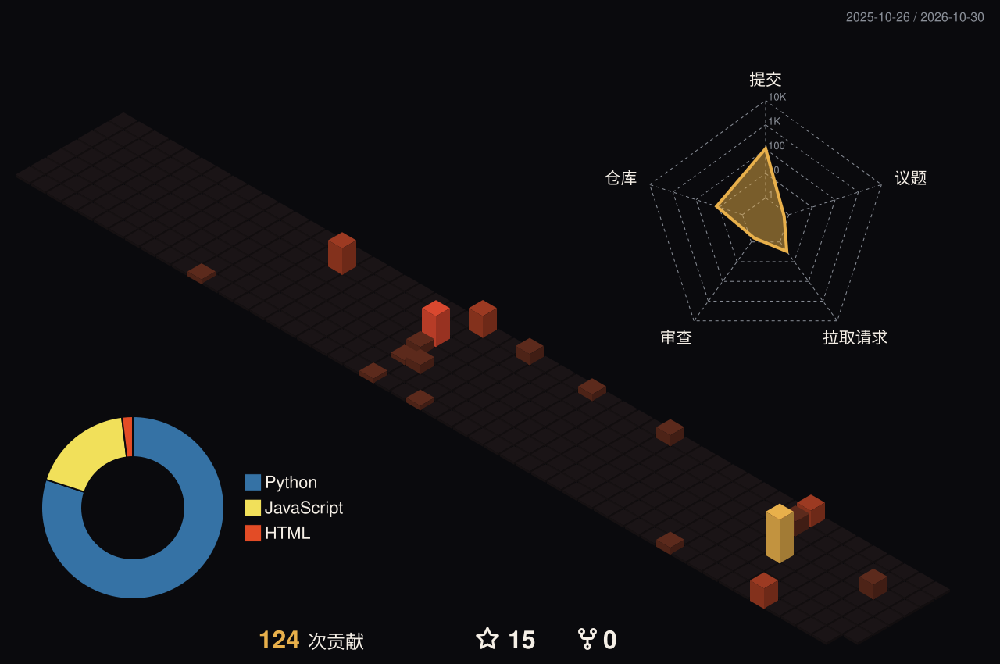

<!-- Profile artwork: python3 tools/make_banner_svg.py -->

**AI 应用开发者 · 全栈实践者 · 自动化工具构建者**

让重复的事自动发生，让复杂的事变得顺手。

[代表作品](#selected-work) · [技术与实践](#engineering) · [联系我](#contact)

 

> **从真实问题出发，交付能用的东西。**
>
> 我是陆逸昊，来自衢州职业技术学院人工智能技术应用专业。我的项目覆盖桌面工具、浏览器扩展和 Web 应用；我关心一个想法如何变成产品，也关心它能否融入日常、持续改进。
>
> **AI 放大创造，工程让创造落地。**

 

## 01 / SELECTED WORK
**作品，比标签更有说服力。**

<table>
<tr>
<td width="50%" valign="top">

<h3><a href="https://github.com/taboo-hacker/qzct-login">QZCT Login</a></h3>

<strong>校园网络，少一次手动操作。</strong>

面向衢州职业技术学院的桌面登录助手，串起 WiFi 连接、校园网认证、断线重连与定时任务，把重复操作收进一个工具。

<code>Python</code> <code>PySide6</code> <code>Automation</code>

<a href="https://github.com/taboo-hacker/qzct-login">查看源码 ↗</a> · <a href="https://github.com/taboo-hacker/qzct-login/releases">下载发布版 ↗</a>

</td>
<td width="50%" valign="top">

<h3><a href="https://github.com/taboo-hacker/simple-dark-mode-reader">Dark Mode &amp; Reader</a></h3>

<strong>把浏览器，调成自己的工作空间。</strong>

为 Chrome / Edge 构建的网页增强扩展，整合深色主题、阅读净化、视频控制和实用工具，让常用操作触手可及。

<code>JavaScript</code> <code>Chromium Extension</code>

<a href="https://github.com/taboo-hacker/simple-dark-mode-reader">查看源码与安装说明 ↗</a>

</td>
</tr>
<tr>
<td width="50%" valign="top">

<h3><a href="https://github.com/taboo-hacker/novel-reader">Novel Reader</a></h3>

<strong>阅读体验，可以从零依赖开始。</strong>

用 Python 标准库构建本地 Web 阅读器：解析 ZIP 文本、识别章节、生成响应式阅读界面。在依赖与功能之间，做更轻的选择。

<code>Python Standard Library</code> <code>Local Web</code>

<a href="https://github.com/taboo-hacker/novel-reader">查看源码 ↗</a>

</td>
<td width="50%" valign="top">

<h3><a href="https://github.com/taboo-hacker/endfield-material-calculator">Endfield Calculator</a></h3>

<strong>用数据，做更清晰的游戏决策。</strong>

终末地物资调度计算器，支持多地区收益计算、策略分析与图表展示。资源本地化，打开即可离线使用。

<code>JavaScript</code> <code>Chart.js</code> <code>Offline</code>

<a href="https://github.com/taboo-hacker/endfield-material-calculator">查看源码 ↗</a>

</td>
</tr>
</table>

**个人主站** → [leo43991314520.top](https://www.leo43991314520.top) 
博客、番剧库、游戏中心与在线 IDE，承载我对全栈产品的持续探索。 
**自建 Git 服务** → [Forgejo](https://git.leo43991314520.top)

 

## 02 / ENGINEERING
**从界面到服务，从想法到部署。**

| 方向 | 技术与实践 |
| :--- | :--- |
| 应用与界面 | Python · TypeScript / JavaScript · Vue 3 · React · PySide6 |
| 服务与数据 | FastAPI · Flask · Express · MySQL · PostgreSQL · SQLite · Redis |
| AI 与自动化 | LLM 应用 · MCP · DeepSeek Harness · Codex · 自动化开发工作流 |
| 部署与协作 | Linux · Docker / Compose · Nginx · GitHub Actions · Forgejo |

<strong>更多技术探索</strong>

 

- **语言与桌面：** Go、C、Node.js、PyQt、Wails、Fyne。
- **前端工程：** Vite、Pinia、Vue Router、Zustand、TanStack Query、Tailwind CSS、PWA。
- **模型与视觉：** PyTorch、Transformer、OpenCV、YOLO、PaddleOCR、scikit-learn。
- **后端工程：** SQLAlchemy、Alembic、APScheduler、Socket.IO、JWT、Zod。
- **观测与质量：** Prometheus、Grafana、Loki、Jaeger、k6、pytest、Playwright、Vitest、Ruff、mypy。

### 工作方式

- **问题先行** — 从自己每天遇到的麻烦出发，做有明确使用场景的工具。
- **端到端实践** — 把界面、逻辑、数据和部署连成完整的使用链路。
- **AI 协作开发** — 用智能体辅助代码审查、重构与自动化，把精力投入设计判断和结果验证。
- **持续打磨** — 跑起来是起点；用得顺手，才值得继续迭代。

 

## 03 / BUILD LOG
**持续构建，留下轨迹。**

  
  

<strong>展开贡献轨迹 / Contribution archive</strong>

 

  <picture>
    <source media="(prefers-color-scheme: light)" srcset="./assets/snake-light.svg" />
    
  </picture>
  

 

## 04 / CONNECT
**有想法，就从一次交流开始。**

欢迎围绕 AI 应用、开发工具和自动化交流，也欢迎在项目中提交 Issue 或 Pull Request。

[邮件联系](mailto:leo43991314520@163.com) · [个人主站](https://www.leo43991314520.top) · [完整站点](https://www.taboo.dpdns.org) · [自建 Git](https://git.leo43991314520.top)

 

Designed with intent. Built through iteration.

